<p align="center">
  
  
  
  
  
  
  
  
</p>

<h1 align="center">🎬 AI Video & Meeting Assistant</h1>

<p align="center">
  <strong>An end-to-end, AI-powered application that transforms any YouTube video or uploaded audio/video recording into structured, actionable knowledge — with a conversational RAG interface to "chat" with your content.</strong>
</p>

<p align="center">
  Paste a YouTube link or drop a meeting recording → Get instant transcripts, AI summaries, action items, key decisions, open questions, and a ChatGPT-style Q&A interface powered by Retrieval-Augmented Generation (RAG).
</p>

---

## 📑 Table of Contents

- [Overview](#-overview)
- [Key Features](#-key-features)
- [High-Level System Architecture](#-high-level-system-architecture)
- [Complete Processing Pipeline](#-complete-processing-pipeline)
- [Backend Architecture Deep-Dive](#-backend-architecture-deep-dive)
  - [Audio Processor (`utils/audio_processor.py`)](#1-audio-processor)
  - [Transcriber (`core/transcriber.py`)](#2-transcriber)
  - [Summarizer (`core/summarizer.py`)](#3-summarizer)
  - [Extractor (`core/extractor.py`)](#4-extractor)
  - [Vector Store (`core/vector_store.py`)](#5-vector-store)
  - [RAG Engine (`core/rag_engine.py`)](#6-rag-engine)
  - [FastAPI Server (`app.py`)](#7-fastapi-server)
- [RAG Pipeline — In-Depth](#-rag-pipeline--in-depth)
- [How LLMs Are Used in This Project](#-how-llms-are-used-in-this-project)
- [LangChain LCEL Chains Explained](#-langchain-lcel-chains-explained)
- [Frontend Architecture Deep-Dive](#-frontend-architecture-deep-dive)
- [API Reference](#-api-reference)
- [Data Flow Diagrams](#-data-flow-diagrams)
- [Project Structure](#-project-structure)
- [Tech Stack](#-tech-stack)
- [Setup & Installation](#-setup--installation)
- [Environment Variables](#-environment-variables)
- [Running the Application](#-running-the-application)
- [Design Decisions & Trade-offs](#-design-decisions--trade-offs)
- [Future Improvements](#-future-improvements)
- [License](#-license)

---

## 🌟 Overview

The **AI Video & Meeting Assistant** is a full-stack application designed to solve a simple but powerful problem: **extracting structured intelligence from unstructured audio/video content**. Whether it's a recorded team meeting, a college lecture, a conference talk, or a YouTube video, this tool will:

1. **Transcribe** the audio using OpenAI Whisper (English) or Sarvam AI (Hinglish/Hindi)
2. **Summarize** the transcript using Mistral LLM with a Map-Reduce strategy
3. **Extract** action items, key decisions, and open questions using targeted LLM chains
4. **Build a knowledge base** by chunking & embedding the transcript into a ChromaDB vector store
5. **Enable conversational Q&A** through a full RAG pipeline (Retrieve → Augment → Generate)

The system has **two interfaces**:
- A **CLI** (`main.py`) for quick terminal-based usage
- A **modern React web app** connected to a **FastAPI REST API** (`app.py`)

---

## ✨ Key Features

| Feature | Description | Powered By |
|---------|-------------|------------|
| 🎥 **YouTube Download** | Download and extract audio from any YouTube URL | `yt-dlp` + `FFmpeg` |
| 📁 **File Upload** | Upload local MP4, MP3, WAV, M4A, MOV files | `pydub` + `FFmpeg` |
| 🎙️ **Speech-to-Text** | Accurate transcription with language routing | OpenAI Whisper (English) / Sarvam AI (Hinglish) |
| 📝 **AI Summary** | Professional Map-Reduce summarization | Mistral LLM via LangChain |
| ✅ **Action Items** | Auto-extract tasks with owners & deadlines | Mistral LLM |
| 🔑 **Key Decisions** | Extract decisions made during meetings | Mistral LLM |
| ❓ **Open Questions** | Find unresolved questions needing follow-up | Mistral LLM |
| 💬 **RAG Chat** | Ask natural language questions about the content | ChromaDB + HuggingFace Embeddings + Mistral |
| 🌐 **Multilingual** | Support for English and Hindi/Hinglish audio | Whisper + Sarvam AI STT-Translate |
| 🖥️ **Premium Web UI** | Dark-themed, animated, modern SaaS-style interface | React 19 + TailwindCSS + Framer Motion |

---

## 🏗️ High-Level System Architecture

```
┌──────────────────────────────────────────────────────────────────────────────────┐
│                              USER INTERFACE LAYER                               │
│                                                                                  │
│   ┌─────────────────────────────────┐   ┌──────────────────────────────────────┐ │
│   │       React 19 Web App          │   │          CLI (main.py)               │ │
│   │  (Vite + TypeScript + Tailwind) │   │     Terminal-based interface         │ │
│   │                                 │   │                                      │ │
│   │  • Landing Page                 │   │  • Interactive prompt input          │ │
│   │  • Dashboard (URL + Upload)     │   │  • Print results to stdout          │ │
│   │  • Results (Tabs: Overview,     │   │  • Chat loop in terminal            │ │
│   │    Summary, Transcript,         │   │                                      │ │
│   │    Insights, Ask AI)            │   │                                      │ │
│   │  • History / Saved / Settings   │   │                                      │ │
│   └──────────────┬──────────────────┘   └───────────────┬──────────────────────┘ │
│                  │ HTTP (Axios)                          │ Direct Python call     │
└──────────────────┼──────────────────────────────────────┼────────────────────────┘
                   │                                      │
┌──────────────────▼──────────────────────────────────────▼────────────────────────┐
│                              API / ORCHESTRATION LAYER                           │
│                                                                                  │
│   ┌──────────────────────────────────────────────────────────────────────────┐   │
│   │                    FastAPI Server (app.py)                               │   │
│   │                                                                          │   │
│   │  POST /process/url      ← YouTube URL processing                        │   │
│   │  POST /process/upload   ← File upload processing                        │   │
│   │  POST /chat             ← RAG question answering                         │   │
│   │  DELETE /session/{id}   ← Session cleanup                                │   │
│   │  GET /                  ← Health check                                   │   │
│   │                                                                          │   │
│   │  In-Memory Session Store: { session_id → pipeline results + rag_chain }  │   │
│   └──────────────────────────────────┬───────────────────────────────────────┘   │
│                                      │                                           │
└──────────────────────────────────────┼───────────────────────────────────────────┘
                                       │
┌──────────────────────────────────────▼───────────────────────────────────────────┐
│                              CORE PROCESSING LAYER                               │
│                                                                                  │
│   ┌──────────┐  ┌──────────────┐  ┌──────────────┐  ┌────────────────────────┐  │
│   │  Audio   │  │  Transcriber │  │  Summarizer  │  │      Extractor         │  │
│   │ Processor│→ │              │→ │              │→ │                        │  │
│   │          │  │ Whisper /    │  │ Map-Reduce   │  │ • Action Items         │  │
│   │ yt-dlp   │  │ Sarvam AI   │  │ via Mistral  │  │ • Key Decisions        │  │
│   │ pydub    │  │              │  │              │  │ • Open Questions       │  │
│   │ FFmpeg   │  │              │  │              │  │                        │  │
│   └──────────┘  └──────────────┘  └──────────────┘  └────────────────────────┘  │
│                                                                                  │
│   ┌────────────────────────────────────────────────────────────────────────────┐ │
│   │                         RAG SUBSYSTEM                                      │ │
│   │                                                                            │ │
│   │  ┌─────────────────┐  ┌─────────────────┐  ┌──────────────────────────┐   │ │
│   │  │  Vector Store    │  │  RAG Engine      │  │  Mistral LLM            │   │ │
│   │  │  (ChromaDB)      │→ │  (LCEL Chain)    │→ │  (Answer Generation)    │   │ │
│   │  │                  │  │                  │  │                          │   │ │
│   │  │  HuggingFace     │  │  Retriever(k=4) │  │  Context-grounded        │   │ │
│   │  │  Embeddings      │  │  + Prompt +      │  │  Responses               │   │ │
│   │  │  (MiniLM-L6-v2)  │  │  LLM Pipeline   │  │                          │   │ │
│   │  └─────────────────┘  └─────────────────┘  └──────────────────────────┘   │ │
│   └────────────────────────────────────────────────────────────────────────────┘ │
└──────────────────────────────────────────────────────────────────────────────────┘
```

---

## 🔄 Complete Processing Pipeline

The following diagram shows the **full end-to-end journey** of content from input to interactive Q&A:

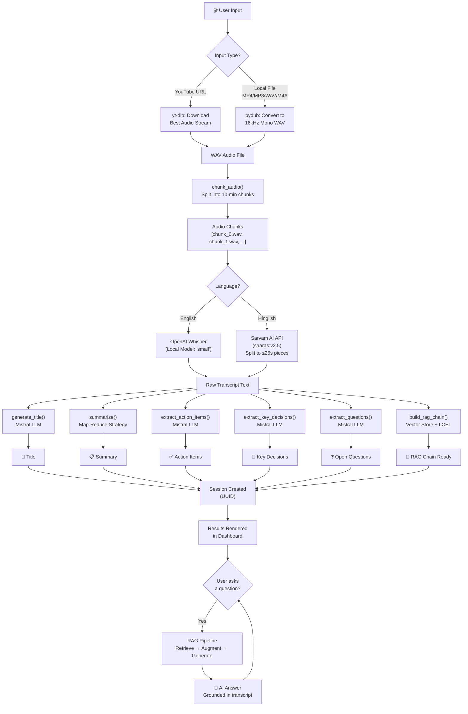

---

## 🔧 Backend Architecture Deep-Dive

### 1. Audio Processor

📁 **File:** `utils/audio_processor.py`

The audio processor is the **entry gate** of the pipeline. It normalizes any input — whether a YouTube URL or a local file — into a list of fixed-duration WAV audio chunks ready for transcription.

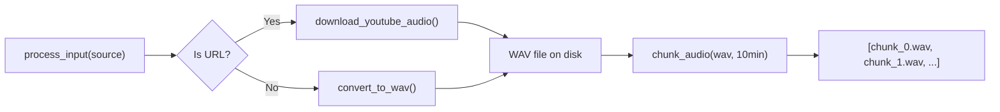

**Key Functions:**

| Function | Purpose | Details |
|----------|---------|---------|
| `download_youtube_audio(url)` | Downloads audio from YouTube | Uses `yt-dlp` with FFmpeg post-processing to extract the best audio stream and convert to WAV |
| `convert_to_wav(input_path)` | Converts any audio/video to WAV | Uses `pydub.AudioSegment`, converts to mono channel at 16kHz sampling rate (optimal for Whisper) |
| `chunk_audio(wav_path, chunk_minutes=10)` | Splits long audio into chunks | Breaks audio at 10-minute boundaries to stay within Whisper's comfort zone. Each chunk is saved as a separate WAV file |
| `process_input(source)` | Main entry point | Routes to YouTube download or local conversion, then chunks the result |

**Why 16kHz Mono?**
- Whisper is trained on 16kHz audio — providing higher sample rates wastes compute without improving accuracy
- Mono reduces file size by 50% compared to stereo, with no loss for speech recognition

**Why 10-minute chunks?**
- Whisper can handle up to ~30 minutes, but accuracy degrades on very long segments
- 10-minute chunks provide a good balance between accuracy and throughput
- Chunks are processed sequentially and concatenated

---

### 2. Transcriber

📁 **File:** `core/transcriber.py`

The transcriber is a **dual-engine speech-to-text system** that routes audio to different STT backends based on the language:

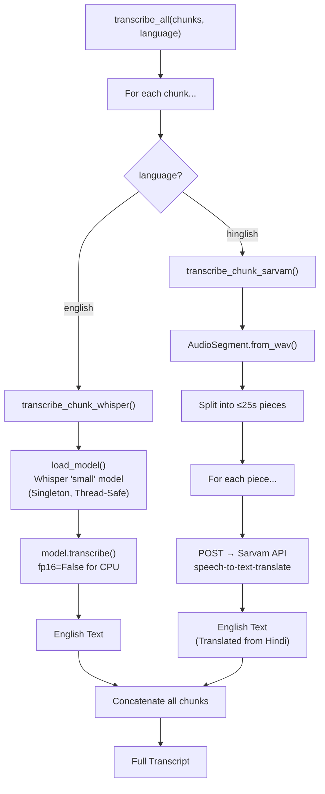

**Engine Details:**

| Engine | Language | Model | Type | Token Limit |
|--------|----------|-------|------|-------------|
| **OpenAI Whisper** | English | `small` (244M params) | Local (on-device) | ~30 min per segment |
| **Sarvam AI** | Hindi/Hinglish | `saaras:v2.5` | Cloud API | ≤30 seconds per request |

**Whisper Architecture (Brief):**
- Whisper is an encoder-decoder Transformer trained on 680K hours of multilingual audio
- The `small` model has 244M parameters — a good balance of speed vs. accuracy
- It uses log-mel spectrograms as input (80 channels, 25ms window, 10ms stride)
- The model is loaded as a **singleton** (`_model` global) and access is **thread-safe** via `threading.Lock`

**Sarvam AI Integration:**
- Sarvam's STT-Translate API simultaneously transcribes Hindi/Hinglish speech AND translates it to English
- The API has a strict 30-second audio limit, so each chunk is further split into 25-second pieces (5s safety margin)
- Pieces are uploaded as WAV via multipart form POST
- Results are joined with spaces to form the full chunk transcript

---

### 3. Summarizer

📁 **File:** `core/summarizer.py`

The summarizer uses a **Map-Reduce pattern** with LangChain LCEL to handle transcripts of any length:

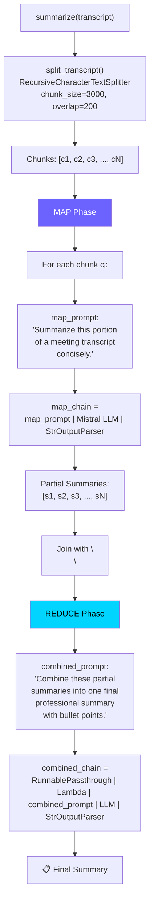

**Why Map-Reduce?**
- LLMs have context window limits (Mistral Small: ~32K tokens)
- A 1-hour meeting transcript can be 15,000+ words (well beyond the context window)
- Map-Reduce solves this by summarizing in two passes:
  1. **Map:** Independently summarize each 3000-character chunk
  2. **Reduce:** Combine all partial summaries into one cohesive summary
- The combined summaries are much shorter than the raw transcript, fitting easily into a single LLM call

**Title Generation (`generate_title`):**
- Takes only the first 2000 characters of the transcript
- Uses a system prompt: *"Generate a short professional meeting title (max 8 words)"*
- Returns only the title string

---

### 4. Extractor

📁 **File:** `core/extractor.py`

The extractor uses **three specialized LLM chains**, each with a targeted system prompt, to extract structured information:

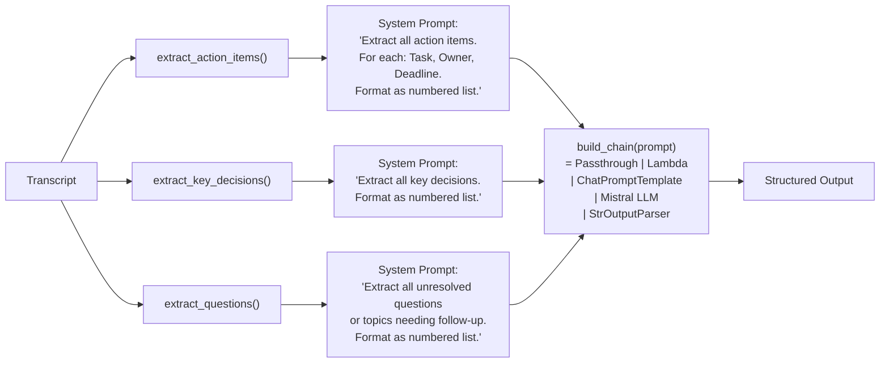

**Chain Construction (`build_chain`):**
All three extractors share the same chain architecture via the `build_chain()` helper:

```python
RunnablePassthrough()           # Pass transcript as-is
| RunnableLambda(lambda x: {"text": x})  # Wrap in dict for prompt template
| ChatPromptTemplate.from_messages([...])  # Format with system + human messages
| ChatMistralAI(model="mistral-small-latest", temperature=0.2)  # Generate
| StrOutputParser()             # Extract string from AIMessage
```

**Note:** The file also contains a **commented-out upgraded version** that uses Map-Reduce chunking (similar to the summarizer) for handling very long meetings. The current active version sends the full transcript in one shot, which works well for meetings under ~45 minutes.

---

### 5. Vector Store

📁 **File:** `core/vector_store.py`

The vector store is the **foundation of the RAG system** — it converts the transcript into searchable semantic vectors:

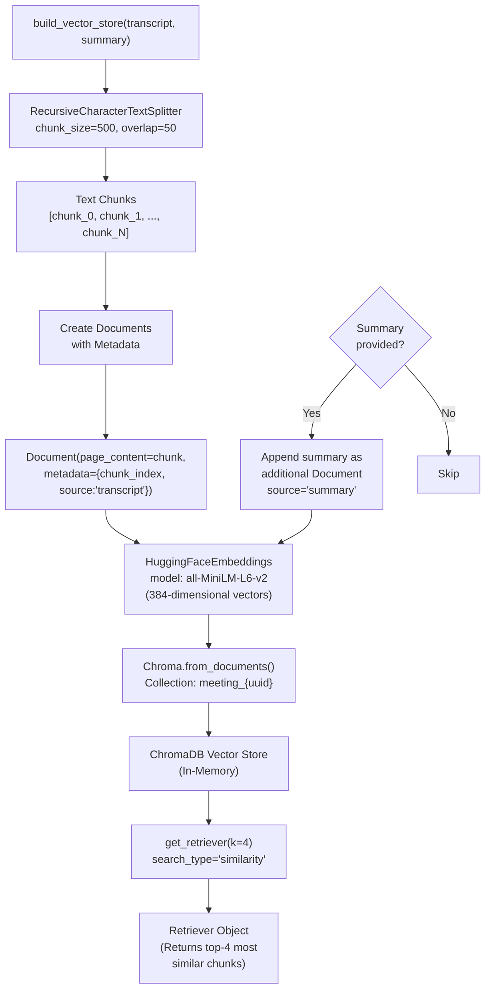

**Embedding Model Details:**

| Property | Value |
|----------|-------|
| Model | `all-MiniLM-L6-v2` (from Sentence-Transformers) |
| Dimensions | 384 |
| Parameters | 22.7M |
| Speed | ~14K sentences/second on CPU |
| Max Sequence Length | 256 word pieces |
| Training Data | 1B+ sentence pairs |

**Why 500-character chunks with 50-character overlap?**
- 500 characters ≈ 70-80 words ≈ a single coherent thought/paragraph
- Smaller chunks allow the retriever to find more precise, relevant passages
- The 50-character overlap prevents information loss at chunk boundaries
- This is smaller than the summarizer's 3000-character chunks because **retrieval precision** is more important than **comprehension breadth**

**Why is the summary also embedded?**
- The summary provides a high-level semantic representation of the entire meeting
- When a user asks a broad question like *"What was this meeting about?"*, the summary chunk will rank highest
- This gives the RAG system both micro (transcript chunks) and macro (summary) context

---

### 6. RAG Engine

📁 **File:** `core/rag_engine.py`

The RAG engine is the **core intelligence layer** that powers the "Ask AI" chat feature. It constructs a full **Retrieve → Augment → Generate** chain using LangChain Expression Language (LCEL):

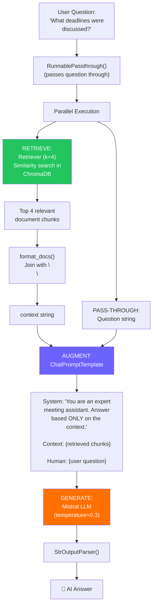

**The LCEL RAG Chain in Code:**

```python
rag_chain = (
    {
        "context": retriever | RunnableLambda(format_docs),   # Retrieve + Format
        "question": RunnablePassthrough()                      # Pass question as-is
    }
    | prompt     # Augment: inject context + question into template
    | llm        # Generate: Mistral produces the answer
    | StrOutputParser()  # Parse AIMessage → string
)
```

**How LCEL Works Here:**
1. The `dict` at the start creates a **parallel branch**: `context` and `question` are computed simultaneously
2. `retriever | format_docs` → the user's question is used as the search query; ChromaDB returns the top-4 most semantically similar chunks; these are joined into a single string
3. `RunnablePassthrough()` → the user's question passes through unchanged
4. Both `context` and `question` are injected into the `ChatPromptTemplate`
5. The formatted prompt goes to `Mistral` which generates a contextually-grounded answer
6. `StrOutputParser` extracts the text from the LLM's `AIMessage` object

**System Prompt Design:**
The RAG system prompt enforces **factual grounding**:
> *"Answer the user's question based ONLY on the meeting transcript context provided below. If the answer is not found in the context, say: 'I could not find this information in the meeting transcript.'"*

This prevents the LLM from hallucinating information that wasn't in the original recording.

---

### 7. FastAPI Server

📁 **File:** `app.py`

The FastAPI server exposes the entire pipeline as a REST API with session management:

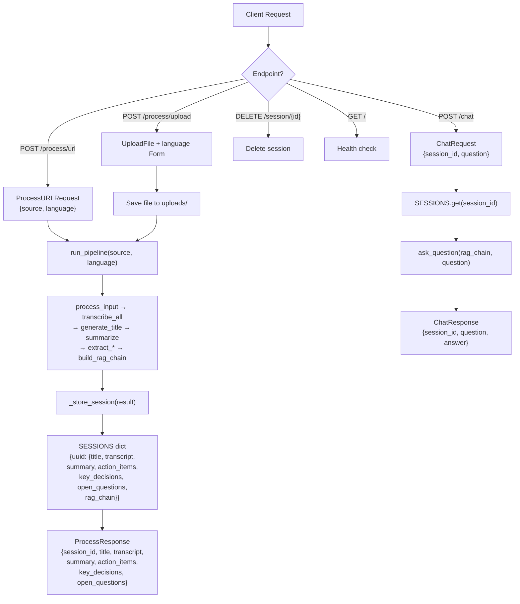

**Session Management:**
- Sessions are stored **in-memory** in a Python `dict` keyed by UUID
- Each session stores the complete pipeline results including the live `rag_chain` object
- Sessions persist for the lifetime of the server process
- The `DELETE /session/{id}` endpoint enables cleanup

**CORS Configuration:**
- All origins are allowed (`*`) for development
- Should be restricted in production deployments

---

## 🔬 RAG Pipeline — In-Depth

RAG (Retrieval-Augmented Generation) is the architecture pattern that enables the "Chat with your meeting" feature. Here is the complete data flow with exact dimensions and parameters:

```
┌─────────────────────────────────────────────────────────────────────────┐
│                          INDEXING PHASE (Build Time)                    │
│                                                                         │
│  Transcript (string, ~5K-50K characters)                                │
│       │                                                                 │
│       ▼                                                                 │
│  RecursiveCharacterTextSplitter(chunk_size=500, overlap=50)             │
│       │                                                                 │
│       ▼                                                                 │
│  Text Chunks: ["chunk_0", "chunk_1", ..., "chunk_N"]                   │
│  + Summary Document (if provided)                                       │
│       │                                                                 │
│       ▼                                                                 │
│  HuggingFaceEmbeddings(model="all-MiniLM-L6-v2")                       │
│       │                                                                 │
│       ▼                                                                 │
│  384-dimensional float vectors: [[0.023, -0.156, ...], ...]             │
│       │                                                                 │
│       ▼                                                                 │
│  ChromaDB (in-memory, collection="meeting_{uuid}")                      │
│  Stores: { document_text, embedding_vector, metadata }                  │
│                                                                         │
└─────────────────────────────────────────────────────────────────────────┘

                              ▼ (one-time, at process time)

┌─────────────────────────────────────────────────────────────────────────┐
│                         QUERY PHASE (Chat Time)                         │
│                                                                         │
│  User Question: "What budget was approved?"                             │
│       │                                                                 │
│       ▼                                                                 │
│  ① RETRIEVE                                                             │
│  Embed the question → 384-dim vector                                    │
│  Cosine similarity search in ChromaDB                                   │
│  Return top-k=4 most relevant document chunks                           │
│       │                                                                 │
│       ▼                                                                 │
│  ② AUGMENT                                                              │
│  Inject retrieved chunks into the prompt template:                      │
│  ┌─────────────────────────────────────────────────────────────────┐    │
│  │ System: "You are an expert meeting assistant. Answer based      │    │
│  │ ONLY on the context. If not found, say so."                     │    │
│  │                                                                 │    │
│  │ Context: {chunk_1}\n\n{chunk_2}\n\n{chunk_3}\n\n{chunk_4}      │    │
│  │                                                                 │    │
│  │ Human: "What budget was approved?"                              │    │
│  └─────────────────────────────────────────────────────────────────┘    │
│       │                                                                 │
│       ▼                                                                 │
│  ③ GENERATE                                                             │
│  Mistral Small LLM (temperature=0.3)                                    │
│  Generates answer grounded in the provided context                      │
│       │                                                                 │
│       ▼                                                                 │
│  Answer: "The team approved a $50K budget for Q3 marketing              │
│  campaigns, as mentioned by the finance lead."                          │
│                                                                         │
└─────────────────────────────────────────────────────────────────────────┘
```

**Similarity Search — How it Works:**

1. The user's question is converted to a 384-dimensional vector using the same `all-MiniLM-L6-v2` model
2. ChromaDB computes the **cosine similarity** between the question vector and every stored chunk vector
3. The 4 chunks with the highest similarity scores are returned
4. These chunks form the "context" that the LLM uses to answer the question

**Why k=4?**
- 4 chunks × 500 chars ≈ 2000 characters of context
- This fits well within Mistral's context window while providing enough relevant information
- Too few chunks (k=1-2) might miss important context; too many (k=8+) could dilute relevance with noise

---

## 🧠 How LLMs Are Used in This Project

This project uses **Mistral AI's `mistral-small-latest` model** for all LLM tasks. Here is a comprehensive map of every LLM call:

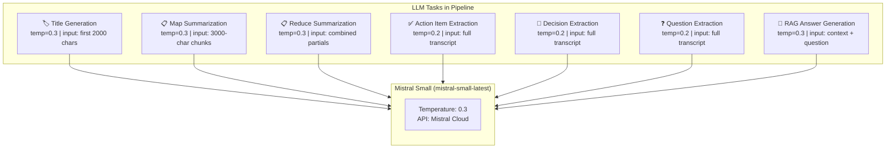

| # | Task | Temperature | Input | System Prompt Strategy |
|---|------|-------------|-------|----------------------|
| 1 | **Title Generation** | 0.3 | First 2000 chars of transcript | "Generate a short professional meeting title (max 8 words)" |
| 2 | **Map Summary** | 0.3 | Each 3000-char chunk | "Summarize this portion of a meeting transcript concisely" |
| 3 | **Reduce Summary** | 0.3 | Joined partial summaries | "Combine partial summaries into one final professional summary with bullet points" |
| 4 | **Action Items** | 0.2 | Full transcript | "Extract all action items with Task, Owner, Deadline" |
| 5 | **Key Decisions** | 0.2 | Full transcript | "Extract all key decisions made. Format as numbered list" |
| 6 | **Open Questions** | 0.2 | Full transcript | "Extract all unresolved questions or topics needing follow-up" |
| 7 | **RAG Answers** | 0.3 | Retrieved context + question | "Answer based ONLY on the meeting transcript context. If not found, say so" |

**Why Mistral Small?**
- Fast inference speeds (important for real-time web app)
- Strong instruction following for structured extraction
- Cost-effective for high-volume processing
- 32K token context window — sufficient for most meeting-length content

**Temperature Settings Explained:**
- **0.2** (Extractors): Lower temperature = more deterministic, factual output. Critical for extracting exact items/decisions
- **0.3** (Summary/RAG): Slightly higher for more natural, fluent language while remaining factual

---

## ⛓️ LangChain LCEL Chains Explained

The project uses **LangChain Expression Language (LCEL)** for composing all LLM chains. LCEL provides a declarative pipe (`|`) syntax for building processing pipelines:

### Chain Pattern Used Throughout

```python
# The base chain pattern (used by extractor, summarizer, rag_engine)
chain = (
    RunnablePassthrough()                    # Step 1: Accept input as-is
    | RunnableLambda(lambda x: {"text": x})  # Step 2: Wrap in dict for template
    | ChatPromptTemplate.from_messages([...])  # Step 3: Format the prompt
    | ChatMistralAI(...)                      # Step 4: Call the LLM
    | StrOutputParser()                       # Step 5: Extract text from response
)
```

### Execution Flow:

```
Input String
     │
     ▼
RunnablePassthrough()     →  "The meeting discussed..."
     │
     ▼
RunnableLambda()          →  {"text": "The meeting discussed..."}
     │
     ▼
ChatPromptTemplate()      →  [SystemMessage("Summarize..."), 
                               HumanMessage("The meeting discussed...")]
     │
     ▼
ChatMistralAI()           →  AIMessage("Here is a summary: ...")
     │
     ▼
StrOutputParser()         →  "Here is a summary: ..."
```

### RAG Chain (More Complex):

```python
rag_chain = (
    {
        "context": retriever | RunnableLambda(format_docs),  # Branch A
        "question": RunnablePassthrough()                     # Branch B
    }
    | prompt | llm | StrOutputParser()
)
```

```
Input: "What deadlines were discussed?"
           │
     ┌─────┴─────┐
     ▼           ▼
  Branch A    Branch B
     │           │
  retriever   passthrough
     │           │
  [Doc1,Doc2]   "What deadlines..."
     │           │
  format_docs    │
     │           │
  "chunk1\n\n   │
   chunk2"       │
     │           │
     └─────┬─────┘
           ▼
    {"context": "chunk1\n\nchunk2",
     "question": "What deadlines..."}
           │
           ▼
      ChatPromptTemplate
           │
           ▼
      Mistral LLM
           │
           ▼
     "The project deadline
      is March 15th..."
```

---

## 🎨 Frontend Architecture Deep-Dive

### Tech Stack

| Technology | Version | Purpose |
|-----------|---------|---------|
| React | 19 | UI library |
| Vite | 8.x | Build tool & dev server |
| TypeScript | 6.x | Type safety |
| TailwindCSS | 3.4 | Utility-first CSS |
| Framer Motion | 12.x | Animations |
| React Router | 7.x | Client-side routing |
| TanStack Query | 5.x | Server state management |
| Axios | 1.x | HTTP client |
| Sonner | 2.x | Toast notifications |
| Lucide React | 1.x | Icon library |
| React Dropzone | 17.x | Drag & drop file upload |
| React Markdown | 10.x | Markdown rendering |

### Application Architecture

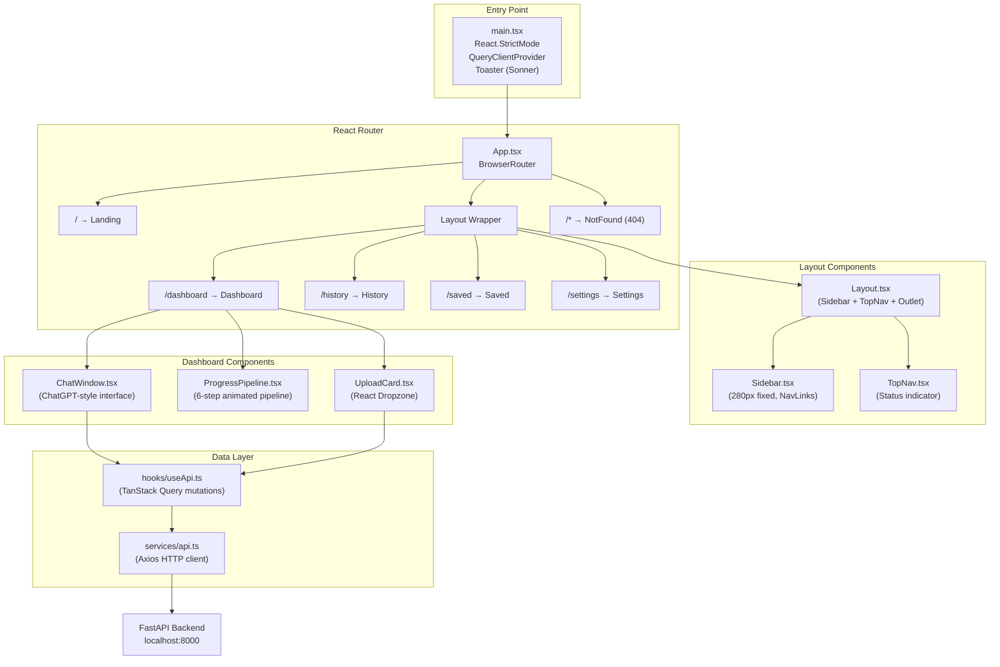

### Page Descriptions

| Page | Route | Description |
|------|-------|-------------|
| **Landing** | `/` | Hero section with gradient text, feature cards, and CTA button. Modern SaaS-style landing page. |
| **Dashboard** | `/dashboard` | Main workspace. URL input with glow effect, drag-and-drop upload, language selector. Shows processing pipeline animation, then results in tabbed view (Overview, Summary, Transcript, Insights, Ask AI). |
| **History** | `/history` | Lists previously processed videos with search and filter (empty state placeholder). |
| **Saved** | `/saved` | Bookmarked/pinned summaries in grid layout (empty state placeholder). |
| **Settings** | `/settings` | Backend URL config, API health status, theme info. |
| **404** | `/*` | Gradient 404 text with return-to-dashboard button. |

### Dashboard State Machine

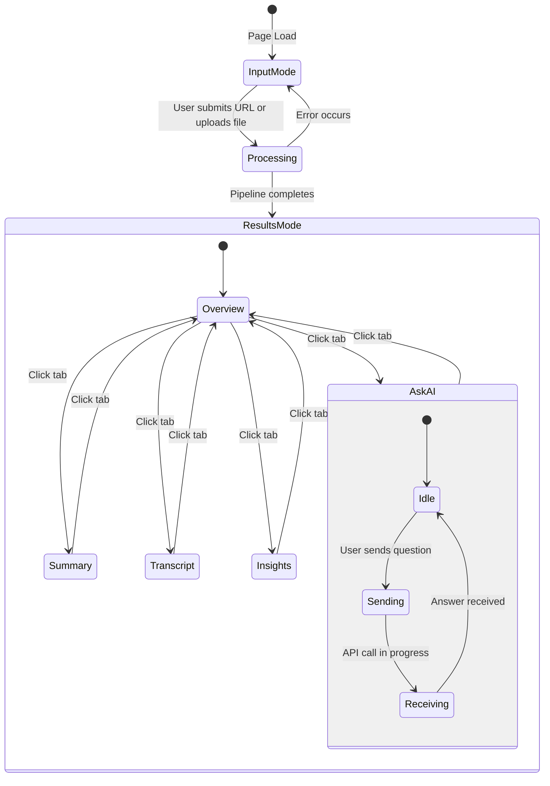

### Design System

| Token | Value | Usage |
|-------|-------|-------|
| Background | `#09090B` | Page background |
| Card | `#111214` | Card surfaces |
| Sidebar | `#0F1012` | Sidebar background |
| Border | `#23262D` | All borders |
| Primary | `#6C63FF` | Buttons, accents, active states |
| Secondary | `#00D4FF` | Gradient endpoint, secondary accents |
| Success | `#22C55E` | Success states, decisions |
| Warning | `#F59E0B` | Warning states, questions |
| Danger | `#EF4444` | Error states |
| Heading Font | `Space Grotesk` | All headings |
| Body Font | `Inter` | Body text |
| Mono Font | `JetBrains Mono` | Code, timestamps, technical text |

---

## 📡 API Reference

### Base URL
```
http://localhost:8000
```

### Endpoints

#### `GET /` — Health Check
```json
// Response 200
{
  "status": "ok",
  "service": "AI Video Assistant API"
}
```

---

#### `POST /process/url` — Process YouTube URL

**Request Body:**
```json
{
  "source": "https://www.youtube.com/watch?v=example",
  "language": "english"   // "english" | "hinglish"
}
```

**Response 200:**
```json
{
  "session_id": "550e8400-e29b-41d4-a716-446655440000",
  "title": "Q3 Marketing Strategy Review",
  "transcript": "Full transcript text...",
  "summary": "## Meeting Summary\n- Point 1\n- Point 2...",
  "action_items": "1. Task A - Owner: John - Deadline: March 15\n2. ...",
  "key_decisions": "1. Approved $50K budget for...\n2. ...",
  "open_questions": "1. Should we expand to EU markets?\n2. ..."
}
```

---

#### `POST /process/upload` — Process Uploaded File

**Request:** `multipart/form-data`

| Field | Type | Description |
|-------|------|-------------|
| `file` | File | Audio/video file (MP4, MP3, WAV, M4A, MOV) |
| `language` | string | `"english"` or `"hinglish"` (default: `"english"`) |

**Response 200:** Same structure as `/process/url`

---

#### `POST /chat` — Chat with Processed Content (RAG)

**Request Body:**
```json
{
  "session_id": "550e8400-e29b-41d4-a716-446655440000",
  "question": "What deadlines were discussed?"
}
```

**Response 200:**
```json
{
  "session_id": "550e8400-e29b-41d4-a716-446655440000",
  "question": "What deadlines were discussed?",
  "answer": "Based on the meeting transcript, the following deadlines were discussed: ..."
}
```

**Response 404:**
```json
{
  "detail": "Session not found. Process a video first."
}
```

---

#### `DELETE /session/{session_id}` — Delete Session

**Response 200:**
```json
{
  "status": "deleted",
  "session_id": "550e8400-e29b-41d4-a716-446655440000"
}
```

---

## 📊 Data Flow Diagrams

### Complete Request Lifecycle (URL Processing)

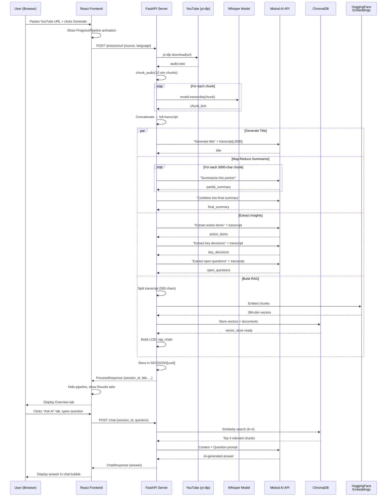

---

## 📁 Project Structure

```
ai-video-assistant/
│
├── 📄 app.py                    # FastAPI REST API server (production entry point)
├── 📄 main.py                   # CLI entry point (terminal-based usage)
├── 📄 test.py                   # Quick test script for pipeline validation
├── 📄 requirements.txt          # Python dependencies
├── 📄 .env                      # API keys (MISTRAL, SARVAM, WHISPER config)
├── 📄 .gitignore                # Git ignore rules
├── 📄 report.md                 # Frontend build specification document
├── 📄 readme.md                 # ← You are here
│
├── 📂 core/                     # Core AI processing modules
│   ├── 📄 transcriber.py        # Dual-engine STT (Whisper + Sarvam AI)
│   ├── 📄 summarizer.py         # Map-Reduce summarization via Mistral
│   ├── 📄 extractor.py          # Action items, decisions, questions extraction
│   ├── 📄 vector_store.py       # ChromaDB vector store + HuggingFace embeddings
│   └── 📄 rag_engine.py         # RAG chain construction + question answering
│
├── 📂 utils/                    # Utility modules
│   └── 📄 audio_processor.py    # YouTube download, WAV conversion, audio chunking
│
├── 📂 uploads/                  # Temporary storage for uploaded files
├── 📂 downloades/               # yt-dlp download directory
│
└── 📂 frontend/                 # React 19 web application
    ├── 📄 package.json          # Node.js dependencies
    ├── 📄 vite.config.ts        # Vite build configuration
    ├── 📄 tailwind.config.js    # TailwindCSS theme configuration
    ├── 📄 tsconfig.json         # TypeScript configuration
    ├── 📄 index.html            # HTML entry point
    │
    └── 📂 src/
        ├── 📄 main.tsx          # React entry point (QueryClient, Toaster)
        ├── 📄 App.tsx           # Router configuration
        ├── 📄 index.css         # Global styles (fonts, base layer)
        ├── 📄 App.css           # Legacy CSS (from Vite scaffold)
        │
        ├── 📂 pages/
        │   ├── 📄 Landing.tsx   # Hero + features landing page
        │   ├── 📄 Dashboard.tsx # Main workspace (URL input, upload, results tabs, chat)
        │   ├── 📄 History.tsx   # Processing history (placeholder)
        │   ├── 📄 Saved.tsx     # Saved summaries (placeholder)
        │   ├── 📄 Settings.tsx  # API config & theme settings
        │   └── 📄 NotFound.tsx  # 404 page
        │
        ├── 📂 components/
        │   ├── 📂 layout/
        │   │   ├── 📄 Layout.tsx    # Sidebar + TopNav + Outlet wrapper
        │   │   ├── 📄 Sidebar.tsx   # Fixed 280px sidebar with navigation
        │   │   └── 📄 TopNav.tsx    # Top bar with system status
        │   ├── 📂 dashboard/
        │   │   ├── 📄 UploadCard.tsx       # Drag-and-drop file upload zone
        │   │   └── 📄 ProgressPipeline.tsx # 6-step animated processing pipeline
        │   └── 📂 chat/
        │       └── 📄 ChatWindow.tsx       # ChatGPT-style Q&A interface
        │
        ├── 📂 services/
        │   └── 📄 api.ts       # Axios HTTP client + typed API functions
        │
        ├── 📂 hooks/
        │   └── 📄 useApi.ts    # TanStack Query mutation hooks
        │
        ├── 📂 lib/
        │   └── 📄 utils.ts    # cn() utility (clsx + tailwind-merge)
        │
        ├── 📂 styles/          # (empty, reserved for additional styles)
        ├── 📂 contexts/        # (empty, reserved for React contexts)
        ├── 📂 types/           # (empty, reserved for shared TypeScript types)
        ├── 📂 utils/           # (empty, reserved for frontend utilities)
        └── 📂 assets/          # Static assets
```

---

## 🛠️ Tech Stack

### Backend

| Technology | Version | Role |
|-----------|---------|------|
| **Python** | ≥ 3.10 | Core language |
| **FastAPI** | Latest | REST API framework |
| **Uvicorn** | Latest | ASGI server |
| **OpenAI Whisper** | ≥ 20231117 | Local speech-to-text |
| **PyTorch** | ≥ 2.2 | Deep learning backend for Whisper |
| **yt-dlp** | ≥ 2024.4 | YouTube audio download |
| **pydub** | ≥ 0.25 | Audio format conversion & chunking |
| **FFmpeg** | System install | Audio/video codec processing |
| **LangChain** | ≥ 0.2 | LLM orchestration framework |
| **LangChain-MistralAI** | ≥ 0.1 | Mistral LLM integration |
| **Mistral AI** (API) | mistral-small-latest | LLM for summarization, extraction, RAG |
| **ChromaDB** | ≥ 0.5 | In-memory vector database |
| **Sentence-Transformers** | ≥ 3.0 | Text embeddings |
| **HuggingFace Hub** | ≥ 0.23 | Model download |
| **Sarvam AI** (API) | saaras:v2.5 | Hindi/Hinglish STT + translation |
| **python-dotenv** | ≥ 1.0 | Environment variable loading |

### Frontend

| Technology | Version | Role |
|-----------|---------|------|
| **React** | 19 | UI library |
| **Vite** | 8.x | Build toolchain |
| **TypeScript** | ~6.0 | Type safety |
| **TailwindCSS** | 3.4 | Utility-first styling |
| **Framer Motion** | 12.x | Animations & transitions |
| **React Router** | 7.x | Client-side routing |
| **TanStack Query** | 5.x | Async state management |
| **Axios** | 1.x | HTTP client |
| **React Dropzone** | 17.x | File upload UI |
| **React Markdown** | 10.x | Markdown rendering |
| **Sonner** | 2.x | Toast notifications |
| **Lucide React** | 1.x | Icon system |
| **clsx + tailwind-merge** | Latest | Conditional className utility |

---

## ⚙️ Setup & Installation

### Prerequisites

- **Python** ≥ 3.10
- **Node.js** ≥ 18
- **FFmpeg** installed on your system
- **Mistral AI API key** (free tier available at [console.mistral.ai](https://console.mistral.ai))
- **Sarvam AI API key** (optional, only for Hinglish support — [sarvam.ai](https://www.sarvam.ai))

### 1. Clone the Repository

```bash
git clone https://github.com/your-username/ai-video-assistant.git
cd ai-video-assistant
```

### 2. Install FFmpeg

```bash
# macOS
brew install ffmpeg

# Ubuntu/Debian
sudo apt update && sudo apt install ffmpeg

# Windows (via Chocolatey)
choco install ffmpeg
```

### 3. Set Up Python Backend

```bash
# Create virtual environment
python -m venv .venv
source .venv/bin/activate  # macOS/Linux
# .venv\Scripts\activate   # Windows

# Install dependencies
pip install -r requirements.txt
```

### 4. Configure Environment Variables

Create a `.env` file in the project root:

```env
MISTRAL_API_KEY=your_mistral_api_key_here
WHISPER_MODEL=small
SARVAM_API_KEY=your_sarvam_api_key_here      # Optional
SARVAM_STT_MODEL=saaras:v2.5                  # Optional
```

### 5. Set Up Frontend

```bash
cd frontend
npm install
```

---

## 🏃 Running the Application

### Option A: Full Stack (Backend + Frontend)

**Terminal 1 — Start Backend:**
```bash
# From project root
source .venv/bin/activate
python app.py
# Server starts at http://localhost:8000
```

**Terminal 2 — Start Frontend:**
```bash
cd frontend
npm run dev
# Dev server starts at http://localhost:5173
```

Open `http://localhost:5173` in your browser.

### Option B: CLI Mode (No Frontend)

```bash
source .venv/bin/activate
python main.py
# Follow the interactive prompts
```

### Option C: Quick Test

```bash
source .venv/bin/activate
python test.py
# Tests the pipeline with a hardcoded YouTube URL
```

---

## 🔐 Environment Variables

| Variable | Required | Default | Description |
|----------|----------|---------|-------------|
| `MISTRAL_API_KEY` | ✅ Yes | — | API key for Mistral AI LLM |
| `WHISPER_MODEL` | No | `small` | Whisper model size (`tiny`, `base`, `small`, `medium`, `large`) |
| `SARVAM_API_KEY` | No | — | API key for Sarvam AI (Hindi/Hinglish support) |
| `SARVAM_STT_MODEL` | No | `saaras:v2.5` | Sarvam STT model identifier |

---

## 🤔 Design Decisions & Trade-offs

| Decision | Rationale | Trade-off |
|----------|-----------|-----------|
| **In-memory sessions** | Simple, fast, no DB setup needed | Sessions lost on server restart. Not suitable for multi-worker deployments |
| **Whisper `small` model** | Good accuracy/speed balance on CPU | Larger models (medium, large) are more accurate but much slower without GPU |
| **ChromaDB in-memory** | No disk persistence needed for single-session use | Vector store is recreated each time; could persist to disk for reuse |
| **500-char RAG chunks** | High retrieval precision for Q&A | Might split a single thought across chunks (mitigated by 50-char overlap) |
| **Full transcript to extractors** | Simpler code, works for most meeting lengths | May fail on very long meetings (>32K tokens). Commented-out Map-Reduce version solves this |
| **Mistral Small for all tasks** | Cost-effective, fast, good enough quality | Larger models (Mistral Large, GPT-4) would produce better summaries for complex content |
| **No authentication** | Development/demo simplicity | Must add auth before any production deployment |
| **CORS allow all origins** | Easy frontend-backend development | Must restrict origins in production |

---

## 🚀 Future Improvements

- [ ] **Persistent storage** — Replace in-memory sessions with PostgreSQL or Redis
- [ ] **User authentication** — Add OAuth2 / JWT-based auth
- [ ] **Streaming responses** — Use SSE or WebSockets for real-time LLM streaming in chat
- [ ] **Speaker diarization** — Identify and label different speakers in the transcript
- [ ] **Multi-language support** — Extend beyond English and Hinglish
- [ ] **PDF/DOCX export** — Download summaries and transcripts as formatted documents
- [ ] **Batch processing** — Process multiple videos in parallel
- [ ] **GPU acceleration** — CUDA support for faster Whisper inference
- [ ] **Larger Whisper models** — Option to use `medium` or `large-v3` for better accuracy
- [ ] **Map-Reduce extractors** — Enable the commented-out chunked extraction for very long meetings
- [ ] **Vector store persistence** — Save ChromaDB to disk for session resume
- [ ] **Frontend history persistence** — Store processing history in localStorage or backend DB
- [ ] **Testing** — Add unit tests for each pipeline stage and integration tests for API endpoints
- [ ] **Docker** — Containerize the full stack for easy deployment
- [ ] **CI/CD** — GitHub Actions for automated testing and deployment

---

## 📄 License

This project is built for educational and demonstration purposes.

---

<p align="center">
  <strong>Built with ❤️ using Whisper, Mistral AI, LangChain, ChromaDB, FastAPI, and React</strong>
</p>
